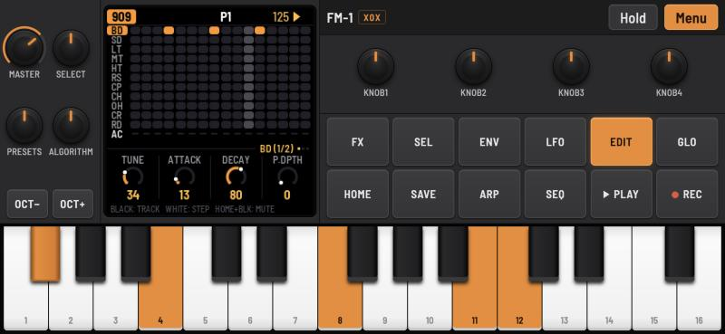
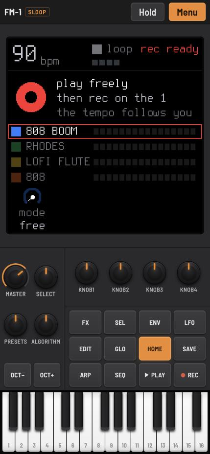

# FM-1 Mobile

The M-VAVE FM-1 on your phone: real FM-1 firmwares, their own C code compiled to WebAssembly, behind a touch panel laid out like the instrument. Pick X0X, Felucca, SLOOP, FiMba-1, Melodee, AMB-1 or HYP-1 in the main menu; More contains GHOULBOX, ChoralRoot (Orchid-style) and MAKU, add the page to your home screen, and it works offline.

**▶ Open it: <https://hb3p8.github.io/fm1-mobile-emu/>**

<p>


</p>

This is a fan project. It is not affiliated with M-VAVE or with the firmwares' authors; M-VAVE and FM-1 are trademarks of their owners.

## The firmwares

| Firmware | What it is | By |
| --- | --- | --- |
| [X0X](https://github.com/charlesvestal/fm1-x0x) 1.1.0 | Drum machine and acid bass line: 909 and 808 drums, a 303, breaks (your own loops too) | Charles Vestal |
| [Felucca](https://github.com/hugelton/Felucca) 1.6.1 | Multi-engine synthesizer: thirteen engines, four tracks, a 64-step sequencer | Leo Kuroshita, Hügelton Instruments |
| [SLOOP](https://github.com/isod89/sloop-fm1) 2.6 | Live groovebox: three synths and a drum machine, song mode, physical models | isod89, after Felucca |
| [FiMba-1](https://github.com/jadamsowers/fm1-fimba) 0.6.1 (pre-release) | A kalimba: modelled tines on a body, thumb-roll chords, mbira patterns | Adam Sowers |
| [Melodee](https://github.com/keremimo/melodee) 1.4.0 | Multi-engine synthesizer: CZ-1, FM6, Prophet, microtonal scales and sequencing | keremimo |
| [AMB-1](https://github.com/charlesvestal/fm1-amb) 1.2 | Generative ambient voices, bells on tape loops and a gliding bass | Charles Vestal |
| [HYP-1](https://github.com/RustyPawz/fm1-HYP1) 1.5.1 | Hypnotic techno and acid with generative voices and sequenced drums | RedtailWorks |
| **More** | | |
| [GHOULBOX](https://github.com/jasonpersinger/ghoulbox-fm1-dungeon-synth) 2.1 | Dungeon synth with cathedral reverb and hurdy-gurdy | Jason Persinger |
| [ChoralRoot](https://github.com/Quixotic7/ChoralRootFM1) 0.22-beta1 (pre-release) | Orchid-style chord instrument: roots, chord shapes, bass and looper | Quixotic7 |
| [MAKU](https://github.com/okumurari2/maku) 0.1 | An always-on ambience machine with random worlds and saved favourites | okumurari |

Each firmware's manual is linked from the menu. All ten have screenshot previews from [the FM-1 Firmware Hub](https://fm1.designburgapps.com/); the images are kept locally for offline use, with original URLs and checksums in `screenshots/sources.json`. Release tags, dates and pre-release status are recorded in `firmware/releases.json`. HYP-1 has no release tags: its current published build version and exact source commit are pinned there. Their saved work (patterns, projects, settings) stays in the browser, separately for each, and survives switching between them.

## Using it

Open the link in Safari or Chrome on the phone. The firmware starts at once; the first touch anywhere starts the sound (browsers allow sound only after a user's action). On an iPhone it plays with the silent switch on.

- **Install:** Share > Add to Home Screen (iOS) or Install app (Android). From the home screen it runs full screen and offline. When a new version is published it is fetched in the background at the next launch with a connection, and taken over at once if you have not touched the page yet, otherwise offered as Menu > Update ready.
- **Panel:** as on the FM-1. MASTER, SELECT, PRESETS and ALGORITHM in a 2×2 block over OCT− / OCT+ (left of the screen in landscape), KNOB1–4 over the twelve function buttons, the 27 keys below. Rotating the phone changes only the layout; the firmware keeps running.
- **Knobs:** drag up or down. **Keys:** several fingers at once, and glide across them.
- **Hold:** latches the buttons you tap until you tap them again, for the FM-1's button combinations with one finger (SEL + another button). On a computer, Shift + click does the same.
- **Menu:** the sound (pause / resume), screen smoothing (xBR, off by default), the firmware, your loops (X0X), help, erasing the current firmware's saved work, the manual and the sources.
- **Computer keyboard:** Space PLAY, Enter REC, Shift SEL, Esc HOME, Z / X OCT− / OCT+, Q–I and A–K the white keys, 1–0 and − the black ones, ↑ / ↓ SELECT.

The screen is the firmware's 240 × 240 frame drawn by the GPU at the display's own pixels: sharp square pixels, at a whole multiple when that costs at most a tenth of the size (on an iPhone XR from the home screen: 2× in landscape, 3× in portrait). Menu > Screen smoothing switches to xBR, the edge-directed filter of retro game emulators.

## How it works

Each firmware is built from its own source with its host simulator: the whole FM-1 application (UI, sequencer, sound engines, storage) against a simulated FM-1 instead of the hardware. It runs in an AudioWorklet: rendering audio advances the device's clock, which runs the firmware's audio interrupt and main loop exactly as on the instrument. Around 30 times a second the worklet sends the screen and the LEDs to the page; the page sends the buttons, keys and knobs back.

| Part | Files |
| --- | --- |
| Panel, layout, input | `index.html`, `style.css`, `panel.js`, `mobile.js`, and X0X's own page script (input, screen, storage), taken from its checkout by `assemble.py` |
| Screen | `screen.js`: WebGL, nearest pixels or xBR level 2 (Hyllian) |
| Firmware choice and start-up | `firmwares.js` (the list), `power.js` (loading, sound, saved work) |
| Firmware builds | `firmware/sources.txt` (pinned commits), `firmware/build.sh`, `firmware/sloop_web.c`, `firmware/flash-worklet.js` |
| Offline | `sw.js`: the service worker; `assemble.py` writes its file list and a version hash |
| The site | `dist/`: what GitHub Pages serves, made by `assemble.py` and committed |

Two kinds of firmware build exist. X0X, FiMba-1, AMB-1 and HYP-1 (the X0X line) keep numbered save objects, kept in localStorage, and come with their own worklet. Felucca, SLOOP, Melodee, GHOULBOX and MAKU (the Felucca line) write a simulated 1 MiB NOR flash; `firmware/flash-worklet.js` sends the page every changed 4 KiB sector, kept in IndexedDB. SLOOP has no browser build of its own: `firmware/sloop_web.c` is Felucca's (`web/emu/felucca_web.c`) fitted to SLOOP's sources, without changing any of them. Melodee similarly uses `firmware/melodee_web.c`: the real DSP, UI and NOR persistence, with its supported one-core audio path. It does not emulate the second hardware CPU, PLL clock switching or USB audio. MAKU uses its own browser build, with a fresh world seed each launch. ChoralRoot uses its own source simulator (`tools/emu/web/emu_web.c`), with its LEDs and staged flash adapted to the shared worklet and the same per-firmware sector storage. HYP-1 uses its own AMB-1-derived source build. The emulator cannot load FM-1 `.fwsc` update packages, which hold machine code for the instrument's processor.

## Building

You need Git, [Emscripten](https://emscripten.org) (`emcc`), and Python 3 with Pillow and fontTools; Pillow needs its text layout (raqm), which on macOS comes with `brew install fribidi`.

```sh
git clone git@github.com:hb3p8/fm1-mobile-emu.git && cd fm1-mobile-emu
python3 -m venv firmware/.venv
firmware/.venv/bin/pip install Pillow fonttools
firmware/build.sh            # clones the ten firmwares into firmware/checkouts/ and builds them into firmware/out/
python3 assemble.py          # writes dist/: the page, the firmwares, sw.js, the source archives
python3 -m http.server 4180 --directory dist --bind 127.0.0.1
```

Open <http://localhost:4180>. Sound needs a secure page, so a phone on the same Wi-Fi cannot use a plain `http://192.168…` address; use the published site, or a tunnel to this server (for example `cloudflared tunnel --url http://localhost:4180`).

`firmware/build.sh x0x felucca` builds only those. The builds are reproducible: the same commits give the same `.wasm` files and the same source archives byte for byte, so only real changes show up in Git. `firmware/.venv/bin/python make_icons.py` redraws the PNG icons after a change to `icon.svg`.

## Updating a firmware

1. Find the commit to use in the firmware's repository (usually its latest release) and put it in `firmware/sources.txt`.
2. `firmware/build.sh <id>`: moves the checkout to that commit, regenerates its tables, fonts and samples, and builds it. It prints the version it found (from the firmware's own sources).
3. `python3 assemble.py`.
4. `node firmware/smoke.mjs` verifies the shipped worklets and WebAssembly: boot, screens, audio, input and saved work restore. Try it locally: start it, play, save something, reload and check it is still there. A firmware that changes its storage format can ignore or reset older saved work; its release notes say so.
5. Commit everything, including `dist/`, and push. GitHub Pages publishes it, and installed copies pick it up at their next launch with a connection.

What can need attention:

- **X0X:** `assemble.py` reuses parts of X0X's page script (`web/emu/index.html`) and edits a few of its lines; it stops with "upstream changed: …" when one of them has moved. Update the matching `tail.replace(...)` line.
- **SLOOP:** `firmware/sloop_web.c` follows SLOOP's `firmware/src/felucca.c` (the order of the sources), `main.c` (the boot steps and the main loop) and the hardware functions they call. When a new SLOOP adds a source file, a boot step or a hardware call, `build.sh sloop` fails to compile or the screen stays dark: compare those files with the previous commit and mirror the change, as Felucca's own `web/emu/felucca_web.c` does for Felucca.
- **Felucca, FiMba-1:** their browser builds are their own (`web/emu/build.sh`); if one changes the exports the worklets use (`web_*`), compare with `firmware/flash-worklet.js` or the firmware's own `worklet.js`.
- **Generated headers:** `build.sh` regenerates them whenever the commit changes; to force it, delete the checkout's `build/` directory.

## Adding a firmware

It needs a browser build of its own source: a host simulator compiled to a standalone `.wasm` with the X0X-style exports (`web_render`, `web_buttons`, `web_keys`, `web_enc`, `web_master`, `web_fb`, `web_lit_buttons`, `web_store*` …) or the Felucca-style ones (`web_nor*`, `web_screen`, `web_flash_writes_count` …). Then add a line to `firmware/sources.txt`, a `case` to `firmware/build.sh`, an entry to `firmwares.js` (name, kind, files, MASTER range) and its files to `FW_FILES` in `assemble.py`.

## Publishing

`.github/workflows/pages.yml` publishes the committed `dist/` to GitHub Pages on every push to `main` (Settings > Pages > Source: GitHub Actions). All paths are relative, so the site works from any folder.

## Licence and credits

GPL-3.0-only (`LICENSE`), as every firmware here. `dist/source.tar.gz` is this app's source; `dist/src/<firmware>.tar.gz` holds each firmware's source tree exactly as built, and both are linked from the menu.

- Firmwares: X0X by Charles Vestal, Felucca by Leo Kuroshita / Hügelton Instruments, SLOOP by isod89, FiMba-1 by Adam Sowers; see each source tree's `LICENSING.md` for the parts they build on.
- The browser emulator design (the device clock driven by the audio worklet) is X0X's, after an idea by Groove OS; the Felucca-family worklet and `sloop_web.c` follow Felucca's browser build.
- Screen filter: xBR level 2 by Hyllian (MIT). The look follows AudioKit Synth One. Font: Barlow Semi Condensed (SIL OFL 1.1).
